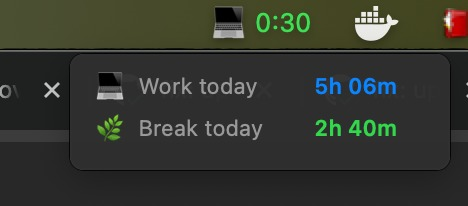
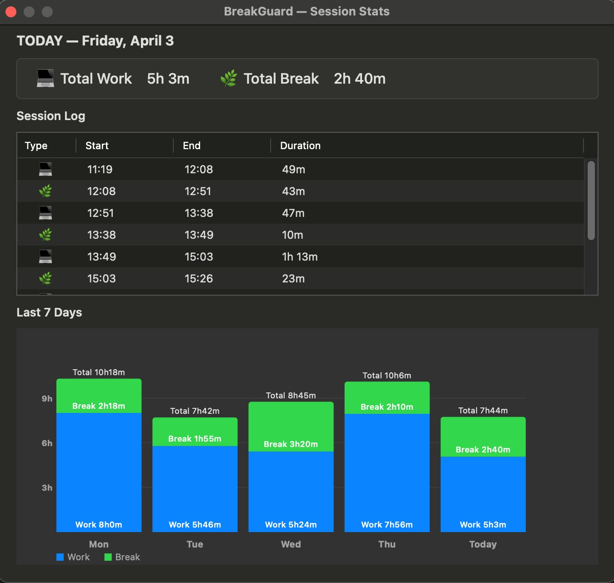

# BreakGuard

**A lightweight macOS menu bar app that reminds you to take breaks — automatically.**

BreakGuard quietly lives in your menu bar and monitors how long you've been working without a break. When you've been heads-down too long, it nudges you with a notification. No manual timers. No babysitting. Just smarter work habits.

---

## Why BreakGuard?

Prolonged uninterrupted work leads to eye strain, mental fatigue, and reduced productivity. Most break-reminder apps are intrusive, hard to configure, or require you to remember to start them. BreakGuard is different:

- **Zero friction** — starts tracking automatically when you unlock your screen
- **Smart detection** — uses macOS screen lock/unlock events, so it always knows when you're working
- **Snooze when you need focus** — one click to pause reminders without stopping the timer
- **Fully configurable** — every threshold and interval is adjustable to your rhythm

---

## Screenshots

<p align="center">
  
  <br/>
  <em>Hover over the icon to see today's work and break time at a glance</em>
</p>

<p align="center">
  
  <br/>
  <em>The Stats window — daily summary, full session log, and a 7-day work/break chart</em>
</p>

---

## Features

### Automatic Work Tracking
BreakGuard detects when you unlock your Mac and starts the clock. Lock your screen — intentionally or to walk away — and the session is recorded automatically. No buttons to press.

### Smart Break Reminders
Set your desired work limit (e.g. 60 minutes) and BreakGuard will notify you when you've hit it. If you keep working, follow-up reminders fire at a configurable interval until you take a break.

### Snooze Without Losing Your Flow
In the middle of something important? Hit **Snooze** directly from the notification. The work timer keeps running, but reminders pause until the snooze expires — so you always know exactly how long you've actually been working.

### Live Menu Bar Status
The menu bar icon shows your current work time and changes color based on state:

| Icon | Color | Meaning |
|------|-------|---------|
| 💻 `HH:MM` | Green | Working — within your limit |
| ⏰ `HH:MM` | Red | Past your work threshold |
| 💤 `HH:MM` | Orange | Snooze active |
| 🌿 `--:--` | Gray | Screen locked |

### Hover Tooltip
Hover over the menu bar icon to instantly see your total work and break time for the day — without opening anything.

### Daily Stats
Open the Stats window to see:
- **Today's summary** — total work and break time at a glance
- **Session log** — every work and break period with start/end times and durations
- **7-day bar chart** — a visual overview of your work/break balance over the past week

### Fully Configurable
Tweak everything to match your workflow:

| Setting | Default | Options |
|---------|---------|---------|
| Work threshold | 60 min | 45, 60, 90 min, or custom (1–480 min) |
| Warning interval | 5 min | 5, 10 min, or custom (1–120 min) |
| Max warnings | 6 | 4, 6, 12, or custom (1–99) |
| Snooze duration | 10 min | 5, 10, 15 min, or custom (1–120 min) |
| Sound | On | Per-event sounds with 14 system sound options |
| Launch at login | Off | Toggle in settings |

### Manual Break Mode
Need to step away for lunch or a meeting? Start a manual break from the menu to explicitly mark that time — it shows up in your stats and pauses the work timer until you're back.

---

## Requirements

- macOS 13 Ventura or later
- Apple Silicon or Intel Mac

---

## Installation

1. Download the latest release
2. Move `BreakGuard.app` to your `/Applications` folder
3. Launch it — the icon will appear in your menu bar
4. Optionally enable **Launch at Login** from the settings menu

---

## Building from Source

BreakGuard has no external dependencies and builds entirely with Swift Package Manager:

```bash
git clone https://github.com/your-username/break-guard.git
cd break-guard
swift build -c release
```

To produce a signed `.app` bundle:

```bash
./build.sh
```

The resulting `BreakGuard.app` will be ready to run.

---

## License

MIT
